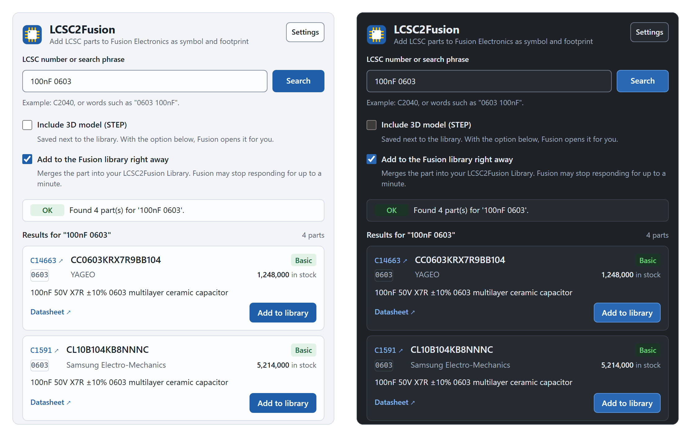
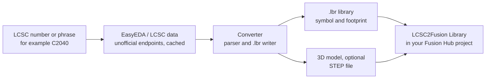
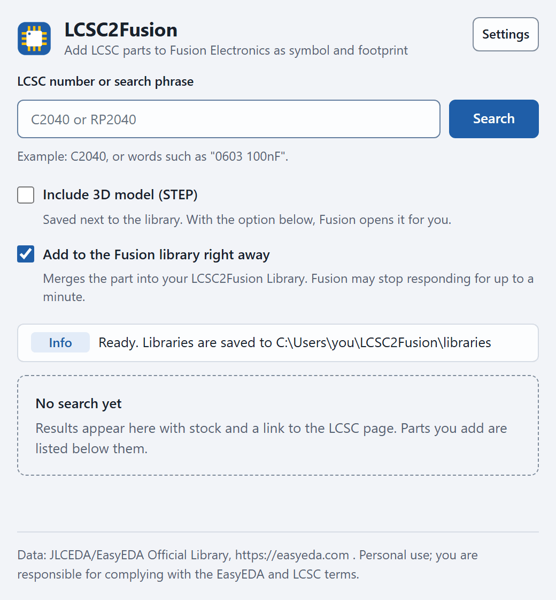
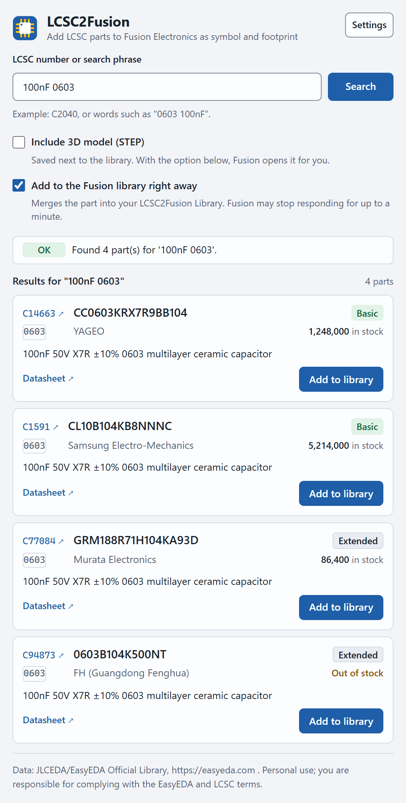
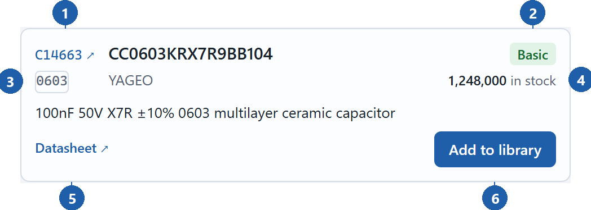
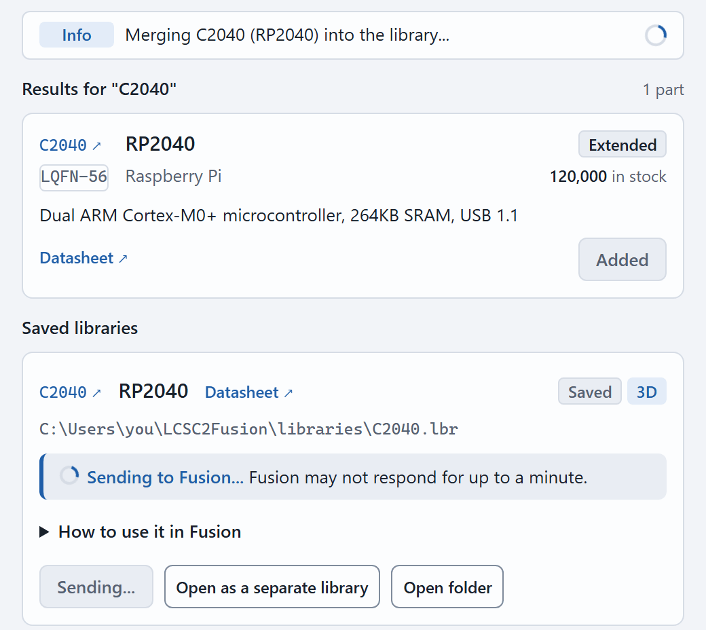
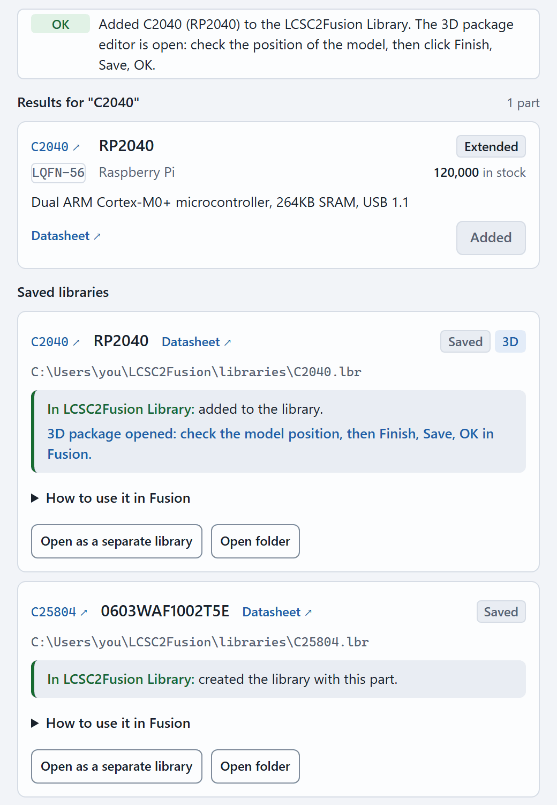
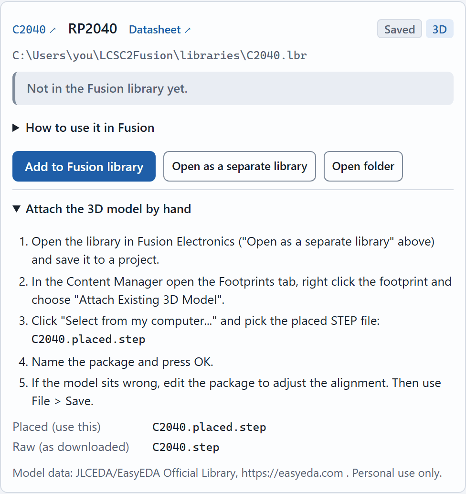
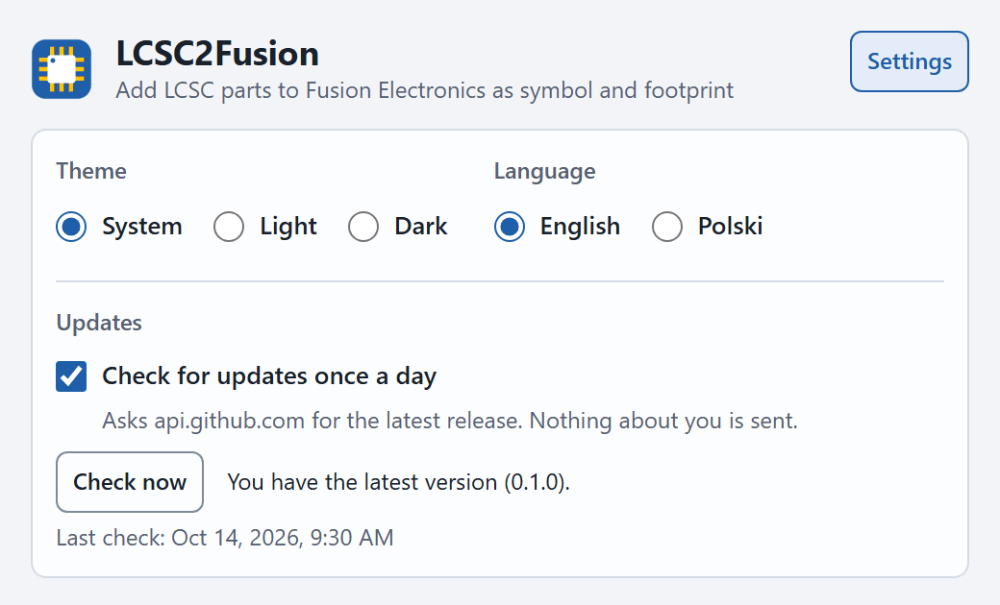

<p align="center">
  
</p>

<h1 align="center">LCSC2Fusion</h1>

<p align="center">
  <b>Search an LCSC part, press one button, and get its symbol, footprint and 3D model into your Autodesk Fusion Electronics library.</b>
</p>

<p align="center">
  <a href="LICENSE"></a>
  
  
  
  
</p>

<p align="center"><b>English</b> | <a href="README.pl.md">Polski</a></p>

<p align="center">
  <a href="#install">Install</a> | <a href="#user-guide">User guide</a> | <a href="#troubleshooting">Troubleshooting</a> | <a href="#command-line">Command line</a> | <a href="#use-from-another-claude-mcp">Claude (MCP)</a> | <a href="#limitations-and-legal">Limitations and legal</a> | <a href="#development">Development</a>
</p>

<p align="center"><picture>
<source media="(prefers-color-scheme: dark)" srcset="docs/img/hero-dark-en.png">

</picture></p>
<p align="center"><sub>The window, light and dark. Example data, not a live search.</sub></p>

LCSC2Fusion is an open source add-in for Autodesk Fusion (Electronics), plus a command line tool and an MCP
server. It takes an LCSC part number (for example `C2040`) or a search phrase, reads the part from the
unofficial EasyEDA/LCSC endpoints and writes an Eagle `.lbr` library with symbol and footprint, optionally
with a 3D model, that Fusion Electronics can use.

- **Search like on LCSC.** Type `C2040` or words such as `100nF 0603`. Every result shows Basic or Extended, stock, and links to the LCSC page and the datasheet.
- **One click into Fusion.** The part is converted and merged into one growing library, "LCSC2Fusion Library", in your active Fusion Hub project. No loose `.lbr` files to import by hand.
- **3D on request.** Fusion opens its 3D package editor with the model already in place. You check it and press Finish.
- **Light or dark, English or Polish.** The window is a normal Edge or Chrome window, so it stays open when Fusion switches environment.
- **Also for scripts and for Claude.** `python -m lcsc2fusion` converts from a terminal, and an MCP server lets Claude add parts for you.

> **Status.** Confirmed by hand in Fusion on Windows: generated libraries import cleanly, the accumulating
> library in the Hub works, the 3D package editor opens with the model in place and the model lines up with the
> footprint (see [DECISIONS.md](DECISIONS.md), D-027). The offline test suite (3900+ tests) covers the converter and
> the add-in logic, and the window is also tested in a real browser. Not yet confirmed by hand in Fusion: the restyled
> window with Settings and LCSC links, and the MCP server (checklist in [docs/MANUAL_TEST.md](docs/MANUAL_TEST.md)).
> This is an unofficial tool, not affiliated with Autodesk, EasyEDA, JLCPCB or LCSC.

## How it works



The core is plain Python (standard library only) and knows nothing about Fusion. The Fusion add-in is a thin
layer on top: it serves a small page on `127.0.0.1`, shows it in its own browser window and calls the Fusion API
on Fusion's main thread.

## Install

Requirements:

- Autodesk Fusion with Electronics, signed in, with a Hub project. Tested on Windows. macOS is untested.
- Edge or Chrome for the window (Edge ships with Windows). Without either, the page opens in your default browser.
- Internet access to EasyEDA and LCSC.
- Python is not needed to use the add-in, it runs on Fusion's own Python. You need Python 3.11 or newer only for the command line tool, the MCP server and for building from source.

### Install with the installer (recommended)

**1. Download.** Open the [latest release](https://github.com/KAJPER/lcsc2fusion/releases/latest) and take one of these files:

- `LCSC2Fusion-Setup-<version>.exe`: one file, just run it.
- `LCSC2Fusion-<version>-installer.zip`: the same installer as readable scripts. Unzip it and double click `Install-LCSC2Fusion.bat`. If Windows marked the zip as blocked, right click it, Properties, Unblock, before unzipping.

**2. Allow it to run.** The installer is not code signed, because signing certificates cost money and this is a small open source project. So Windows SmartScreen may say "Windows protected your PC" and name an "unknown publisher". Click "More info", then "Run anyway". Some antivirus programs are also wary of self extracting exe files. If yours is, use the zip: it holds plain scripts that you can read before you run them.

**3. Install.** The installer checks its files against a checksum list and copies the add-in to `%APPDATA%\Autodesk\FusionAddins\LCSC2Fusion`, replacing an older version. It works per user, needs no administrator rights, no network and no Python. The exe asks once and shows the result in a message box; its log is `%TEMP%\LCSC2Fusion-setup.log`.

**4. Start the add-in.** Start Fusion: the add-in runs on startup and adds its button. If Fusion was already running, press Shift+S (or Utilities, Add-Ins, Scripts and Add-Ins), open the Add-Ins tab, select LCSC2Fusion and press Stop, then Run. The window opens at once. Later, LCSC2Fusion is in the Utilities tab, ADD-INS panel, of the Design, Schematic, Board and Library environments. Pressing the button while the window is open brings that window to the front.

**Check the download (optional).** `SHA256SUMS.txt` on the release page lists the SHA-256 hash of every file. In PowerShell, in the folder with the download:

```
Get-FileHash .\LCSC2Fusion-Setup-<version>.exe -Algorithm SHA256
```

The hash must equal the line for that file in `SHA256SUMS.txt`.

**First start.** A separate Edge or Chrome window without address bar opens, with its own private profile in
`%LOCALAPPDATA%\LCSC2Fusion\browser-profile`. It talks to the add-in over `127.0.0.1` on a random port, so nothing
is reachable from other computers and no firewall prompt is expected. With "Run on Startup", Fusion only adds the
buttons at start and the window opens on the first click. Stopping the add-in closes the window.

**Update.** Download the newer installer and run it again, then Stop and Run the add-in in Fusion (or restart Fusion).

**Uninstall.** Run `Uninstall-LCSC2Fusion.bat` from the installer zip, or delete the folder `%APPDATA%\Autodesk\FusionAddins\LCSC2Fusion`. This removes only the add-in. Your own data stays: `%LOCALAPPDATA%\LCSC2Fusion` (the added parts, the window's profile) and the libraries in `C:\Users\<you>\LCSC2Fusion`. To delete `%LOCALAPPDATA%\LCSC2Fusion` too, run `Uninstall-LCSC2Fusion.bat -RemoveData` in a console (it asks first). Your `.lbr` files are never deleted by the uninstaller.

**macOS.** The manifest allows it, but I have not run it there. Take `LCSC2Fusion-<version>-addin.zip` from the release, extract it and use the green plus in Scripts and Add-Ins to add the extracted folder, instead of guessing the Add-Ins folder.

### Build from source (developers)

Needs Python 3.11 or newer. The installer files are built from the same sources (maintainers: see [RELEASING.md](RELEASING.md)).

**1. Get the code.**

```
git clone https://github.com/KAJPER/lcsc2fusion.git
cd lcsc2fusion
```

Or use "Code", "Download ZIP" on [GitHub](https://github.com/KAJPER/lcsc2fusion) and unpack it.

**2. Build the add-in package** (standard library only, no pip install):

```
python scripts/build_addin.py
```

This creates `dist/LCSC2Fusion/` and `dist/LCSC2Fusion.zip` (the folder is the root of the zip).

**3. Put it where Fusion looks for add-ins.** Extract the zip into `%APPDATA%\Autodesk\FusionAddins\` so that
this file exists: `%APPDATA%\Autodesk\FusionAddins\LCSC2Fusion\LCSC2Fusion.manifest`. In PowerShell:

```
Expand-Archive -Path dist\LCSC2Fusion.zip -DestinationPath "$env:APPDATA\Autodesk\FusionAddins" -Force
```

Alternative: in Fusion use the green plus in Scripts and Add-Ins and pick the `dist/LCSC2Fusion` folder.

**4. Run it in Fusion.** Press Shift+S, open the Add-Ins tab, select LCSC2Fusion and press Run. Tick "Run on
Startup" to have the button after every Fusion start. The rest is as in "First start" above.

**Update.** `git pull`, build again, extract over the old folder, then Stop and Run the add-in in Fusion.

## User guide

Fusion's own dialogs change between versions, so this guide describes them in words and does not show Fusion
screenshots. The pictures below are the add-in window with example data.

### 1. Search

Type an LCSC number such as `C2040`, or words such as `100nF 0603`, and press Search or Enter. Up to 20 results
are listed.

<p align="center"><picture>
<source media="(prefers-color-scheme: dark)" srcset="docs/img/ui-idle-dark-en.png">

</picture></p>

### 2. Read a result

<p align="center"><picture>
<source media="(prefers-color-scheme: dark)" srcset="docs/img/ui-results-dark-en.png">

</picture></p>
<p align="center"><sub>Example data: part numbers, descriptions and stock are illustrative.</sub></p>

<p align="center"><picture>
<source media="(prefers-color-scheme: dark)" srcset="docs/img/ui-row-dark-en.png">

</picture></p>

1. The LCSC number is a link to the part's page on lcsc.com. It opens in a new browser tab and the window stays.
2. Basic or Extended, the part class shown by LCSC and JLCPCB. It matters only if you order assembly from JLCPCB.
3. The package name as LCSC lists it.
4. Stock at LCSC, or "Out of stock".
5. A Datasheet link, shown only when the datasheet is an https link on lcsc.com, jlcpcb.com or easyeda.com.
6. Add to library.

The manufacturer part number (MPN) and the manufacturer are in the middle of the row.

### 3. Choose the options

| Include 3D model (STEP) | Add to the Fusion library right away | Result |
| --- | --- | --- |
| off (default) | on (default) | Symbol and footprint are merged into "LCSC2Fusion Library". |
| on | on | The same, then Fusion opens the 3D package editor with the model in place. |
| any | off | Only files are written. The saved card then offers "Add to Fusion library" for later. |

### 4. Add the part

Press "Add to library". The status line follows the steps (download, build the library, merge) and the row button
turns into "Added".

<p align="center"><picture>
<source media="(prefers-color-scheme: dark)" srcset="docs/img/ui-working-dark-en.png">

</picture></p>

What happens in Fusion:

- **First part.** Fusion creates and saves a library named "LCSC2Fusion Library" in the root folder of your
  active Hub project. **Next parts** are merged into the same library, and the file version in the Data Panel
  goes up. The library shows up in Fusion's Library Manager like any other.
- **The same part again** is not merged twice: "already in the LCSC2Fusion Library, so it was not added again".
- **Fusion is busy for up to about a minute** while it merges and, with 3D, imports the model. It may stop responding.
  This is normal. Do not click in Fusion until the status line says it is done.
- **With 3D**, Fusion opens a 3D package editor with the model in place. Check that the model sits on the
  pads, stands upright and is turned like the footprint (pin 1 and markers), then press Finish, then Save, then
  OK. If Fusion shows the library as modified, save it (File, Save).
- **When two parts use a package with the same name but different geometry**, the add-in renames the new package
  before merging, so nothing is overwritten.

### 5. Saved libraries

Every added part gets a card under "Saved libraries".

<p align="center"><picture>
<source media="(prefers-color-scheme: dark)" srcset="docs/img/ui-added-dark-en.png">

</picture></p>

- The card shows the LCSC link, the MPN, the datasheet link, the badges "Saved" and "3D", and the path of the `.lbr`
  (by default `C:\Users\<you>\LCSC2Fusion\libraries\<id>.lbr`).
- The coloured box says where the part is: "In LCSC2Fusion Library: added to the library." or "Not in the Fusion
  library yet." Failures are shown there too, with the reason.
- **Add to Fusion library** appears while the part is not in the library yet (for example when you unticked the
  option). **Open as a separate library** opens just this `.lbr` as its own document in the Electronics editor; save
  it into a project afterwards. **Open folder** shows the files in Explorer.
- Without the Fusion hand-off, a card with 3D lists the manual steps to attach the model:

<p align="center"><picture>
<source media="(prefers-color-scheme: dark)" srcset="docs/img/ui-manual-3d-dark-en.png">

</picture></p>

### 6. Settings

The Settings button in the header opens a small panel. Theme: System (follows Windows), Light or Dark. Language:
English or Polski. The first start takes the language of the window's browser. Both choices are remembered in
the window's own browser profile and applied at once, without losing results or cards.

<p align="center"><picture>
<source media="(prefers-color-scheme: dark)" srcset="docs/img/ui-settings-dark-en.png">

</picture></p>

## Troubleshooting

| Problem | What to do |
| --- | --- |
| Windows says "Windows protected your PC" when I run the installer. | The installer is not code signed. Choose "More info", then "Run anyway", or use the installer zip and read its scripts first. See Install. |
| LCSC2Fusion is not in the Add-Ins list. | Run the installer again, or check that `%APPDATA%\Autodesk\FusionAddins\LCSC2Fusion\LCSC2Fusion.manifest` exists (not one folder deeper). If you extracted a zip by hand, unblock it first (Properties, Unblock). Or add the folder with the green plus. Restart Fusion. |
| The window does not open. | Run the add-in (Shift+S, Add-Ins). Press the toolbar button again. Stop and Run once. Look at the Text Commands window for lines starting with `[LCSC2Fusion]`. |
| The button is missing in one environment. | The Text Commands window has `button: ... -> added, exists, missing or failed` lines per environment. Use the button in Design meanwhile. |
| "The request failed." or "Lost the connection to Fusion." | The window cannot reach the add-in: Fusion was closed, the add-in stopped, or Fusion did not answer for a long time. Make sure Fusion runs and the add-in is started, then try again. A window left over from an earlier session can be closed. |
| Fusion stops responding for up to a minute. | Normal while it merges a part or imports a 3D model (about 50 s for a small STEP file). Wait. The log may show "Hang detected" and Fusion recovers. |
| A dialog "Can't rename ... Error code: 5". | A rare Fusion error seen once, right after a library was first created (DECISIONS.md, D-026). Close the dialog. If the part is missing afterwards, add it again: the window tells you when it is already there. Please report it with the Fusion log if it keeps coming back. |
| "Fusion has no project to keep the library in." | Sign in to a Hub and pick a project in the Data Panel, then add the part again. |
| The part is "already in the LCSC2Fusion Library". | Nothing to do. With the 3D box ticked, the 3D package is made again. If you deleted the library in Fusion, the add-in notices and creates a new one. |
| The 3D model lies on its side. | Should not happen since D-026. If it does, adjust it in the package editor and please report the part with its `<id>.3d.json`. |
| Fusion runs in another language. | The manual 3D steps quote the English captions (Content Manager, Footprints, Attach Existing 3D Model, Select from my computer...). Other Fusion languages use other captions, so look for the equivalent entries. |
| "... blocked the request (HTTP 403)" or "Requests to ... are paused". | The endpoints are unofficial and may refuse requests. Such blocks usually clear within a few minutes, and the message says how long to wait. While it lasts, new requests are refused on purpose, so do not repeat searches in a loop. |

## Command line

```
python -m lcsc2fusion C2040 -o out/                   # writes out/C2040.lbr
python -m lcsc2fusion C2040 C14663 -n mylib -o out/   # several parts in one library
python -m lcsc2fusion --search 100nF 0603             # list search results
python -m lcsc2fusion 100nF 0603 --pick 1 -o out/     # convert the first search result
python -m lcsc2fusion C2040 --render -o out/          # also write footprint and symbol PNGs
python -m lcsc2fusion C25804 --3d -o out/             # also download the 3D model (STEP)
python -m lcsc2fusion --help                          # all options
```

The default output folder is `out`. Responses are cached on disk for 7 days and requests are rate limited. Use
`--no-cache` to refetch. The converter itself needs nothing but Python. `--render` needs matplotlib (`pip install -r requirements-dev.txt`
in a virtual environment).

<table align="center"><tr>
<td align="center"></td>
<td align="center"></td>
</tr></table>
<p align="center"><sub>What <code>--render</code> writes, here for synthetic example parts from <code>tests/fixtures/synthetic</code> (not real LCSC data). The thermal pad (pad 17) is a plain SMD pad in the output.</sub></p>

**3D files.** With `--3d` (the "Include 3D model (STEP)" box in the window), three files are written next to the `.lbr`:

| File | What it is |
| --- | --- |
| `<id>.placed.step` | The model moved into the package frame: millimetres, Z up, origin at the footprint origin, bottom on the board. Use this one. |
| `<id>.step` | The model as downloaded. It is not aligned with the footprint (for C25804 it was turned by 90 degrees), so do not use it directly. |
| `<id>.3d.json` | Placement, checksums and attribution. |

From the command line you attach the model yourself: open the library, Content Manager, Footprints, right click the
footprint, "Attach Existing 3D Model", "Select from my computer...", pick `<id>.placed.step`. The 3D data belongs
to JLCEDA/EasyEDA: personal use only, do not redistribute the STEP files.

## Use from another Claude (MCP)

`python -m lcsc2fusion.mcp` is an MCP server (stdio, standard library only). Claude Code or Claude Desktop can
search LCSC, inspect a part, convert it, and, through the running add-in, add it to your Fusion library.

1. Install nothing. Start `claude` in the repository folder (Python 3.11+ on `PATH`).
2. Approve the project server `lcsc2fusion` from `.mcp.json` when Claude Code asks. It runs code from this
   folder, so read the file first.
3. Start Fusion with the add-in running and ask, for example: "Add the RP2040 C2040 with its 3D model to my Fusion library."

Tools: `lcsc_search`, `lcsc_part_info`, `lcsc_convert`, `fusion_status`, `fusion_add_part`, `fusion_job`.
Registration for other folders and Claude Desktop, the local add-in API, security notes and an example
conversation are in [docs/MCP.md](docs/MCP.md). The terms below apply: do not use it for bulk scraping.

## Limitations and legal

- **Terms of service.** EasyEDA's terms forbid bulk or systematic automated access and the use of its content for
  machine learning, and its `robots.txt` disallows `/api/`. This tool fetches single parts on user request with
  caching and rate limiting, but you are responsible for complying with the EasyEDA/JLCEDA and LCSC terms. The
  library data stays the property of JLCEDA/EasyEDA, and generated libraries carry the required attribution
  ("JLCEDA/EasyEDA Official Library", https://lceda.cn/, https://easyeda.com). Commercial use of the data is
  granted by EasyEDA only when used in EasyEDA. This is not legal advice.
- The endpoints are unofficial and can change or start blocking without notice.
- Fusion's Electronics API is read only. Opening the generated library uses undocumented text commands (with a
  manual fallback), which may change between Fusion builds.
- Lossy conversions: polygon pads become rectangles, through-hole rectangles become square pads, per pad
  mask/paste expansion is not representable, thermal pads are plain SMD pads, and oval through-hole pads follow
  the DRC elongation.
- Non-plated pads (Eagle has none) are written as plated pads. Symbol pins keep the EasyEDA 1.27 mm grid, so
  Fusion may report "off grid" pins for some symbols. Multi-unit symbols become several gates. Datasheet links
  are best effort.
- Rotation and arc direction conventions were derived from sample data and checked against EasyEDA previews, and
  the 3D placement was confirmed in Fusion for three parts. The pad rotation and arc rules are not yet confirmed
  in Fusion. Check a generated footprint against the datasheet (`--render` helps) before ordering a board.
- Fusion freezes for up to a minute while it merges a part, and the add-in handles one part at a time.
- Autodesk, Fusion, EasyEDA, JLCPCB and LCSC are trademarks of their owners. This project is not affiliated with them.

## Development

```
python -m venv .venv
.venv\Scripts\activate            # on macOS/Linux: source .venv/bin/activate
pip install -r requirements-dev.txt
python -m pytest                  # offline tests, no network
ruff check . && ruff format .
mypy lcsc2fusion
```

The committed fixtures in `tests/fixtures/synthetic/` are generated by `tests/fixtures/synthetic/generate.py`
together with independently computed expected values (pad positions, sizes, pin positions in mm). Tests marked
`real` additionally use `tests/fixtures/real/*.json` (EasyEDA responses downloaded with
`python scripts/fetch_fixtures.py`); that directory is gitignored because the content belongs to EasyEDA.
`python scripts/make_manual_test_assets.py` builds the files for the manual checklist in
[docs/MANUAL_TEST.md](docs/MANUAL_TEST.md) (in Polish).

To work on the add-in without a build, add `addin/LCSC2Fusion` with the green plus in Scripts and Add-Ins. To
see the window without Fusion, open `addin/LCSC2Fusion/palette/index.html` in a browser: it switches to a mock mode
with fake data. Details are in [addin/README.md](addin/README.md); research and decisions are in
[docs/RESEARCH.md](docs/RESEARCH.md) and [DECISIONS.md](DECISIONS.md).

## Project structure

```
lcsc2fusion/            the core, no adsk import
  client/               HTTP, disk cache, rate limiting, retry, search
  parser/               EasyEDA shape strings to the internal model (one place for units and axes)
  lbr_writer/           model to Eagle XML, plus a linter for Fusion compatibility
  render.py             footprint and symbol PNG/SVG for visual checks
  step.py, service.py   3D model transform and the high level conversion used by all front ends
  cli/                  command line
  mcp/                  MCP server for other Claudes
addin/LCSC2Fusion/      Fusion add-in: manifest, adapter (the only adsk module), controller, window page
installer/              Windows installer scripts (install, uninstall)
scripts/                build_addin.py, build_release.py and helper scripts
tests/                  pytest, fixtures, golden files
docs/                   RESEARCH.md, MANUAL_TEST.md, MCP.md, img/
.github/workflows/      CI (ruff, mypy, pytest) and the release workflow
CHANGELOG.md            what changed in each version
RELEASING.md            how a release is made (for maintainers)
```

## Contributing

Issues and pull requests are welcome, especially reports from other Fusion versions and from macOS. Before a pull
request run pytest, ruff and mypy (see Development), keep texts free of long dashes (a test checks it), do not add
a dependency without a reason noted in [DECISIONS.md](DECISIONS.md), and never commit EasyEDA responses. Commit
messages look like `fix: short description`. The same checks run on GitHub for every pull request. Changes users
will notice go into [CHANGELOG.md](CHANGELOG.md) under "Unreleased".

## License

MIT, see [LICENSE](LICENSE). EasyEDA/LCSC data is not covered by this license. Data source: JLCEDA/EasyEDA
Official Library, https://easyeda.com .
