<p align="center">
  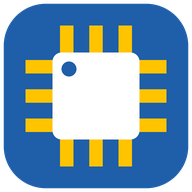
</p>

<h1 align="center">LCSC2Fusion</h1>

<p align="center">
  <b>Wyszukaj część z LCSC, kliknij jeden przycisk i dostaniesz jej symbol, footprint oraz model 3D w bibliotece Autodesk Fusion Electronics.</b>
</p>

<p align="center">
  <a href="LICENSE"></a>
  
  
  
  
</p>

<p align="center"><a href="README.md">English</a> | <b>Polski</b></p>

<p align="center">
  <a href="#instalacja">Instalacja</a> | <a href="#instrukcja-obsługi">Instrukcja obsługi</a> | <a href="#7-aktualizacje">Aktualizacje</a> | <a href="#rozwiązywanie-problemów">Rozwiązywanie problemów</a> | <a href="#wiersz-poleceń">Wiersz poleceń</a> | <a href="#użycie-z-innym-claude-mcp">Claude (MCP)</a> | <a href="#ograniczenia-i-kwestie-prawne">Ograniczenia i prawo</a> | <a href="#polityka-podpisywania-kodu">Polityka podpisywania kodu</a> | <a href="#prywatność">Prywatność</a> | <a href="#rozwój-projektu">Rozwój projektu</a>
</p>

<p align="center"><picture>
<source media="(prefers-color-scheme: dark)" srcset="docs/img/hero-dark-pl.png">
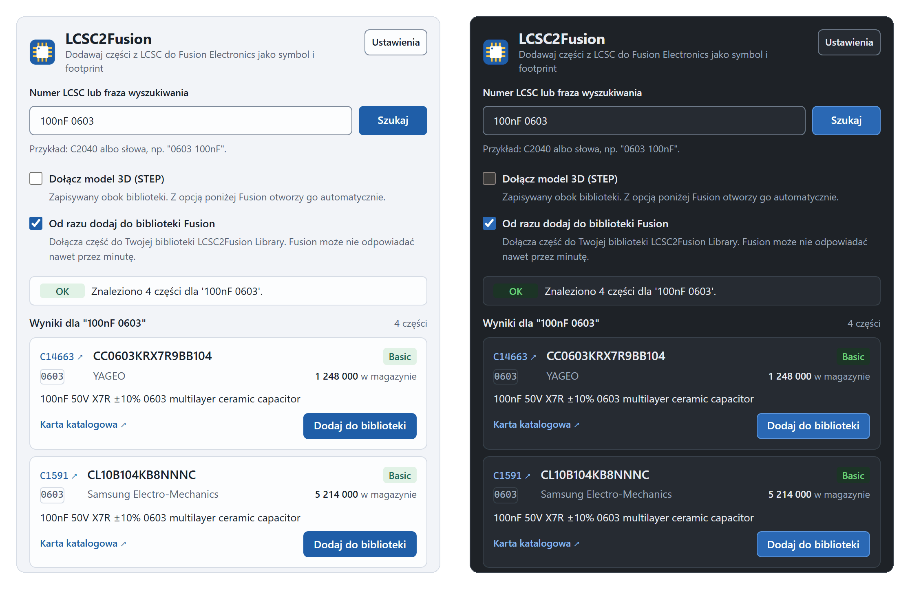
</picture></p>
<p align="center"><sub>Okno w jasnym i ciemnym motywie. Dane przykładowe, to nie jest prawdziwe wyszukiwanie.</sub></p>

LCSC2Fusion to otwarty (open source) dodatek do Autodesk Fusion (Electronics), a do tego narzędzie wiersza
poleceń i serwer MCP. Przyjmuje numer części z LCSC (na przykład `C2040`) albo frazę wyszukiwania, pobiera część
z nieoficjalnych endpointów EasyEDA/LCSC i zapisuje bibliotekę Eagle `.lbr` z symbolem i footprintem, opcjonalnie
z modelem 3D, której może użyć Fusion Electronics.

- **Wyszukiwanie jak na LCSC.** Wpisz `C2040` albo słowa, na przykład `100nF 0603`. Każdy wynik pokazuje Basic lub Extended, stan magazynowy oraz linki do strony LCSC i karty katalogowej.
- **Jedno kliknięcie do Fusion.** Część jest konwertowana i dołączana do jednej rosnącej biblioteki „LCSC2Fusion Library” w aktywnym projekcie Hub we Fusion. Żadnych luźnych plików `.lbr` do ręcznego importu.
- **3D na życzenie.** Fusion otwiera edytor pakietu 3D z modelem już ustawionym na miejscu. Sprawdzasz go i klikasz Finish.
- **Jasny lub ciemny motyw, polski lub angielski.** Okno to zwykłe okno Edge albo Chrome, więc zostaje otwarte, gdy Fusion przełącza środowisko.
- **Informuje o aktualizacjach.** Gdy wyjdzie nowsze wydanie, okno o tym mówi i podaje link do instalatora. Samo niczego nie pobiera ani nie instaluje, a sprawdzanie możesz wyłączyć.
- **Także dla skryptów i dla Claude.** `python -m lcsc2fusion` konwertuje z terminala, a serwer MCP pozwala Claude dodawać części za Ciebie.

> **Stan projektu.** Potwierdzone ręcznie we Fusion na Windows: wygenerowane biblioteki importują się bez błędów,
> zbiorcza biblioteka w Hubie działa, edytor pakietu 3D otwiera się z modelem na miejscu, a model pasuje do
> footprintu (zob. [DECISIONS.md](DECISIONS.md), D-027). Testy offline (3900+) obejmują konwerter i logikę
> dodatku, a okno jest dodatkowo testowane w prawdziwej przeglądarce. Jeszcze niepotwierdzone ręcznie we
> Fusion: odświeżone okno z ustawieniami i linkami do LCSC, powiadomienie o aktualizacji oraz serwer MCP (lista
> kontrolna w [docs/MANUAL_TEST.md](docs/MANUAL_TEST.md)). To narzędzie nieoficjalne, niepowiązane z Autodesk,
> EasyEDA, JLCPCB ani LCSC.

## Jak to działa

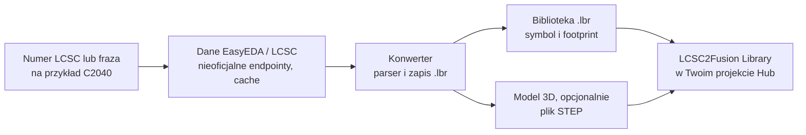

Rdzeń to czysty Python (tylko biblioteka standardowa) i nic nie wie o Fusion. Dodatek do Fusion jest cienką
warstwą na wierzchu: udostępnia małą stronę pod `127.0.0.1`, pokazuje ją we własnym oknie przeglądarki i woła
API Fusion na głównym wątku Fusion.

## Instalacja

Wymagania:

- Autodesk Fusion z Electronics, zalogowany, z projektem w Hubie. Testowane na Windows. macOS nie był testowany.
- Edge lub Chrome dla okna (Edge jest częścią Windows). Bez żadnej z nich strona otworzy się w domyślnej przeglądarce.
- Dostęp do internetu: do EasyEDA, LCSC i JLCPCB (dane części) oraz do GitHuba (opcjonalne sprawdzanie aktualizacji). Dokładna lista hostów i tego, co jest wysyłane, jest w sekcji [Prywatność](#prywatność).
- Python nie jest potrzebny do używania dodatku, działa on na Pythonie wbudowanym we Fusion. Python 3.11 lub nowszy jest potrzebny tylko do narzędzia wiersza poleceń, serwera MCP i budowania ze źródeł.

### Instalacja instalatorem (zalecana)

**1. Pobierz.** Otwórz [najnowsze wydanie](https://github.com/KAJPER/lcsc2fusion/releases/latest) i weź jeden z tych plików:

- `LCSC2Fusion-Setup-<version>.exe`: jeden plik, wystarczy go uruchomić.
- `LCSC2Fusion-<version>-installer.zip`: ten sam instalator w postaci czytelnych skryptów. Rozpakuj go i kliknij dwukrotnie `Install-LCSC2Fusion.bat`. Jeśli Windows oznaczył zip jako zablokowany, przed rozpakowaniem kliknij go prawym przyciskiem, Właściwości (Properties), Odblokuj (Unblock).

**2. Zezwól na uruchomienie.** Instalator nie jest jeszcze podpisany cyfrowo, bo certyfikaty do podpisywania kosztują, a to mały projekt open source (starania o darmowy podpis trwają, zob. [Polityka podpisywania kodu](#polityka-podpisywania-kodu)). Dlatego Windows SmartScreen może napisać „System Windows ochronił ten komputer” i podać „nieznanego wydawcę”. Kliknij „Więcej informacji”, potem „Uruchom mimo to”. Niektóre programy antywirusowe są też podejrzliwe wobec samorozpakowujących się plików exe. Jeśli Twój tak reaguje, użyj zipa: zawiera zwykłe skrypty, które możesz przeczytać przed uruchomieniem.

**3. Zainstaluj.** Instalator sprawdza swoje pliki z listą sum kontrolnych i kopiuje dodatek do `%APPDATA%\Autodesk\FusionAddins\LCSC2Fusion`, zastępując starszą wersję. Działa dla bieżącego użytkownika, nie wymaga praw administratora, sieci ani Pythona. Exe pyta raz i pokazuje wynik w oknie komunikatu; jego log to `%TEMP%\LCSC2Fusion-setup.log`.

**4. Uruchom dodatek.** Uruchom Fusion: dodatek startuje razem z nim i dodaje swój przycisk. Jeśli Fusion już działał, naciśnij Shift+S (albo Utilities, Add-Ins, Scripts and Add-Ins), otwórz kartę Add-Ins, zaznacz LCSC2Fusion i naciśnij Stop, potem Run. Okno otwiera się od razu. Później LCSC2Fusion jest na karcie Utilities, w panelu ADD-INS, w środowiskach Design, Schematic, Board i Library. Kliknięcie przycisku, gdy okno jest już otwarte, wysuwa to okno na wierzch.

**Sprawdzenie pobranego pliku (opcjonalne).** `SHA256SUMS.txt` na stronie wydania zawiera skrót SHA-256 każdego pliku. W PowerShellu, w folderze z pobranym plikiem:

```
Get-FileHash .\LCSC2Fusion-Setup-<version>.exe -Algorithm SHA256
```

Skrót musi być taki sam jak w linii tego pliku w `SHA256SUMS.txt`.

**Pierwszy start.** Otwiera się osobne okno Edge lub Chrome bez paska adresu, z własnym prywatnym profilem w
`%LOCALAPPDATA%\LCSC2Fusion\browser-profile`. Rozmawia z dodatkiem przez `127.0.0.1` na losowym porcie, więc
nic nie jest dostępne z innych komputerów i nie powinien pojawić się monit zapory. Z „Run on Startup” Fusion przy
starcie tylko dodaje przyciski, a okno otwiera się przy pierwszym kliknięciu. Zatrzymanie dodatku zamyka okno.

**Aktualizacja.** Pobierz nowszy instalator i uruchom go ponownie, potem Stop i Run dodatku we Fusion (albo uruchom Fusion od nowa). Okno informuje, gdy wyjdzie nowsza wersja, zob. [Aktualizacje](#7-aktualizacje).

**Odinstalowanie.** Uruchom `Uninstall-LCSC2Fusion.bat` z zipa instalatora albo usuń folder `%APPDATA%\Autodesk\FusionAddins\LCSC2Fusion`. To usuwa tylko dodatek. Twoje dane zostają: `%LOCALAPPDATA%\LCSC2Fusion` (lista dodanych części, pamięć podręczna pobranych danych, ustawienia aktualizacji, profil okna) oraz biblioteki w `C:\Users\<ty>\LCSC2Fusion`. Wszystkie pliki wymienia sekcja [Prywatność](#prywatność). Aby usunąć też `%LOCALAPPDATA%\LCSC2Fusion`, uruchom w konsoli `Uninstall-LCSC2Fusion.bat -RemoveData` (najpierw zapyta). Pliki `.lbr` nigdy nie są usuwane przez dezinstalator.

**macOS.** Manifest na to pozwala, ale nie uruchamiałem tego tam. Weź z wydania `LCSC2Fusion-<version>-addin.zip`, rozpakuj go i użyj zielonego plusa w Scripts and Add-Ins, aby dodać rozpakowany folder, zamiast zgadywać folder Add-Ins.

### Budowanie ze źródeł (dla programistów)

Wymaga Pythona 3.11 lub nowszego. Pliki instalatora powstają z tych samych źródeł (dla opiekunów projektu: zob. [RELEASING.md](RELEASING.md), po angielsku).

**1. Pobierz kod.**

```
git clone https://github.com/KAJPER/lcsc2fusion.git
cd lcsc2fusion
```

Albo użyj „Code”, „Download ZIP” na [GitHubie](https://github.com/KAJPER/lcsc2fusion) i rozpakuj archiwum.

**2. Zbuduj paczkę dodatku** (tylko biblioteka standardowa, bez `pip install`):

```
python scripts/build_addin.py
```

Powstają `dist/LCSC2Fusion/` oraz `dist/LCSC2Fusion.zip` (folder jest korzeniem archiwum).

**3. Umieść ją tam, gdzie Fusion szuka dodatków.** Rozpakuj zip do `%APPDATA%\Autodesk\FusionAddins\` tak, aby
istniał plik `%APPDATA%\Autodesk\FusionAddins\LCSC2Fusion\LCSC2Fusion.manifest`. W PowerShellu:

```
Expand-Archive -Path dist\LCSC2Fusion.zip -DestinationPath "$env:APPDATA\Autodesk\FusionAddins" -Force
```

Alternatywa: we Fusion użyj zielonego plusa w Scripts and Add-Ins i wskaż folder `dist/LCSC2Fusion`.

**4. Uruchom we Fusion.** Naciśnij Shift+S, otwórz kartę Add-Ins, zaznacz LCSC2Fusion i naciśnij Run. Zaznacz
„Run on Startup”, aby przycisk był po każdym starcie Fusion. Dalej jest tak, jak w „Pierwszy start” powyżej.

**Aktualizacja.** `git pull`, zbuduj ponownie, rozpakuj na stary folder, potem Stop i Run dodatku we Fusion.

## Instrukcja obsługi

Okna Fusion zmieniają się między wersjami, więc ta instrukcja opisuje je słowami i nie pokazuje zrzutów ekranu
Fusion. Poniższe obrazki to okno dodatku z danymi przykładowymi.

### 1. Wyszukiwanie

Wpisz numer LCSC, na przykład `C2040`, albo słowa, na przykład `100nF 0603`, i naciśnij Szukaj lub Enter.
Lista zawiera do 20 wyników.

<p align="center"><picture>
<source media="(prefers-color-scheme: dark)" srcset="docs/img/ui-idle-dark-pl.png">
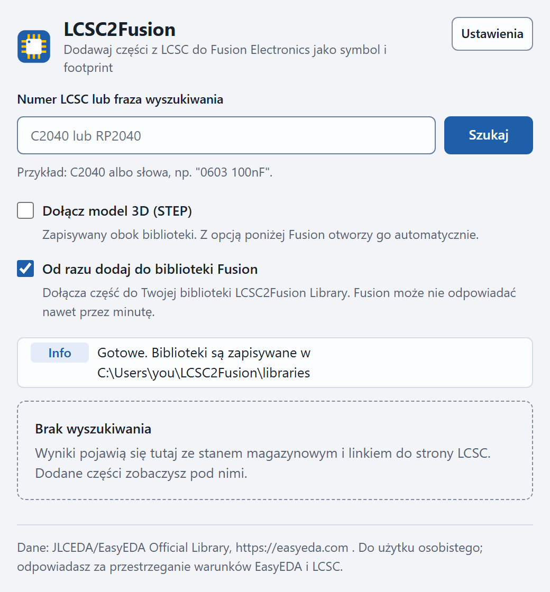
</picture></p>

### 2. Jak czytać wynik

<p align="center"><picture>
<source media="(prefers-color-scheme: dark)" srcset="docs/img/ui-results-dark-pl.png">
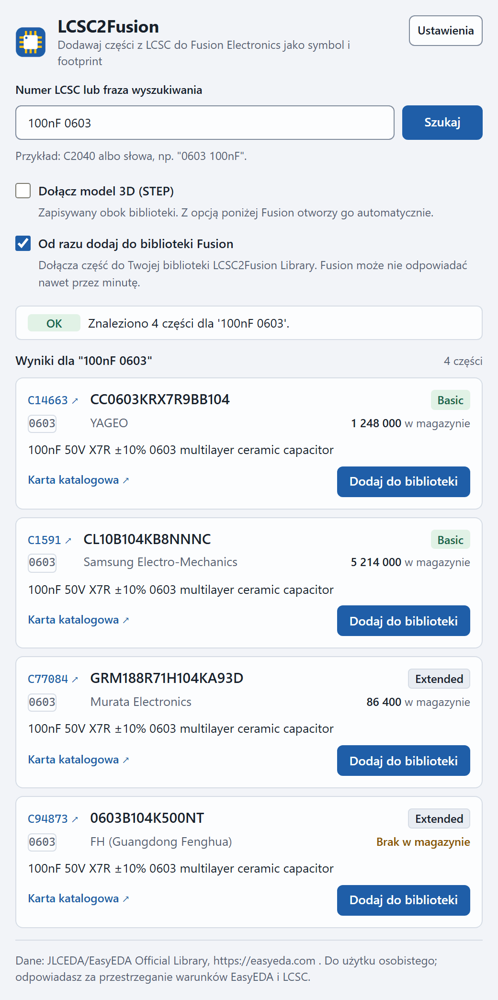
</picture></p>
<p align="center"><sub>Dane przykładowe: numery części, opisy i stany magazynowe są poglądowe.</sub></p>

<p align="center"><picture>
<source media="(prefers-color-scheme: dark)" srcset="docs/img/ui-row-dark-pl.png">
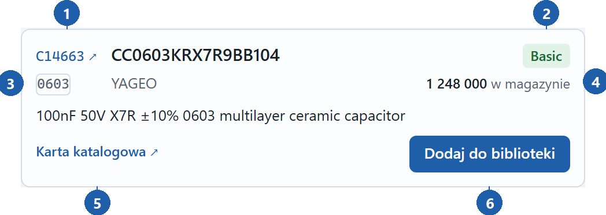
</picture></p>

1. Numer LCSC to link do strony części na lcsc.com. Otwiera się w nowej karcie przeglądarki, a okno zostaje.
2. Basic lub Extended, czyli klasa części podawana przez LCSC i JLCPCB. Ma znaczenie tylko przy zamawianiu montażu w JLCPCB.
3. Nazwa obudowy tak, jak podaje ją LCSC.
4. Stan magazynowy w LCSC albo „Brak w magazynie”.
5. Link „Karta katalogowa”, pokazywany tylko wtedy, gdy karta jest linkiem https na lcsc.com, jlcpcb.com lub easyeda.com.
6. Dodaj do biblioteki.

Numer producenta (MPN) i nazwa producenta są w środku wiersza.

### 3. Wybór opcji

| Dołącz model 3D (STEP) | Od razu dodaj do biblioteki Fusion | Wynik |
| --- | --- | --- |
| wyłączone (domyślnie) | włączone (domyślnie) | Symbol i footprint są dołączane do „LCSC2Fusion Library”. |
| włączone | włączone | To samo, a potem Fusion otwiera edytor pakietu 3D z modelem na miejscu. |
| dowolnie | wyłączone | Zapisywane są tylko pliki. Karta zapisanej części oferuje potem „Dodaj do biblioteki Fusion”. |

### 4. Dodawanie części

Naciśnij „Dodaj do biblioteki”. Pasek statusu pokazuje kolejne kroki (pobranie, budowa biblioteki, dołączenie), a
przycisk w wierszu zmienia się na „Dodano”.

<p align="center"><picture>
<source media="(prefers-color-scheme: dark)" srcset="docs/img/ui-working-dark-pl.png">
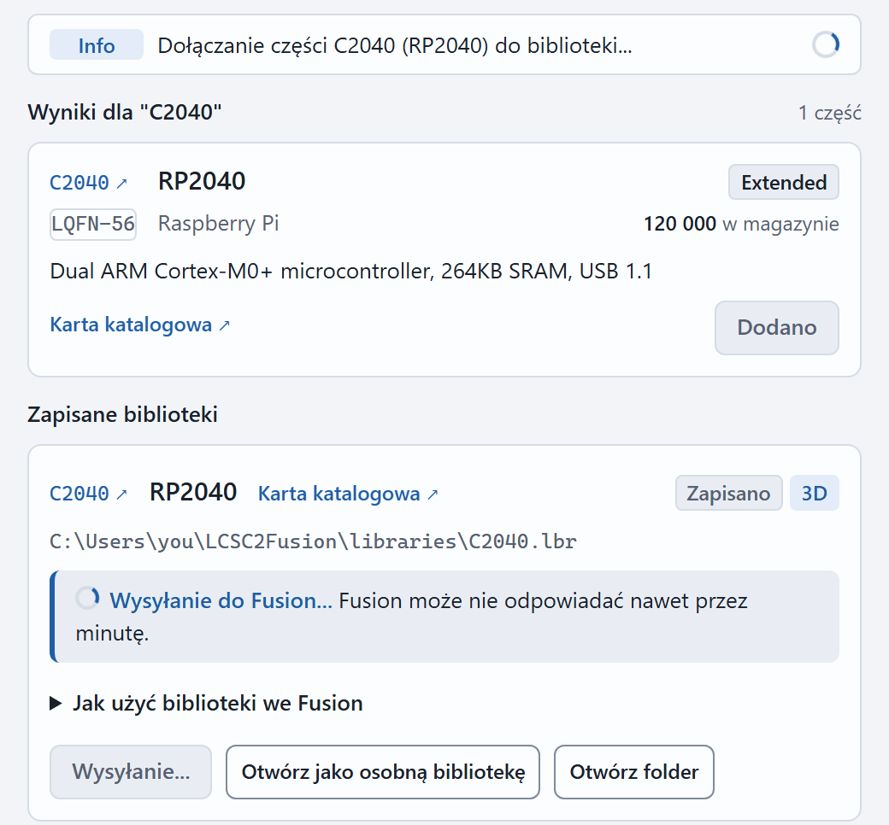
</picture></p>

Co dzieje się we Fusion:

- **Pierwsza część.** Fusion tworzy i zapisuje bibliotekę o nazwie „LCSC2Fusion Library” w katalogu głównym
  aktywnego projektu Hub. **Kolejne części** są dołączane do tej samej biblioteki, a wersja pliku w Data Panel
  rośnie. Biblioteka pojawia się w Library Managerze Fusion jak każda inna.
- **Ta sama część jeszcze raz** nie jest dołączana dwa razy: „już tam jest, nie dodano ponownie”.
- **Fusion jest zajęty do mniej więcej minuty** podczas dołączania i, przy 3D, importu modelu. Może przestać
  odpowiadać. To normalne. Nie klikaj we Fusion, dopóki status nie powie, że skończono.
- **Z 3D** Fusion otwiera edytor pakietu 3D z modelem na miejscu. Sprawdź, czy model leży na padach, stoi prosto i
  jest obrócony jak footprint (pin 1 i znaczniki), potem kliknij Finish, następnie Save, następnie OK. Jeśli
  Fusion pokazuje bibliotekę jako zmienioną, zapisz ją (File, Save).
- **Gdy dwie części mają pakiet o tej samej nazwie, ale innej geometrii**, dodatek zmienia nazwę nowego pakietu
  przed dołączeniem, więc nic nie zostaje nadpisane.

### 5. Zapisane biblioteki

Każda dodana część dostaje kartę w sekcji „Zapisane biblioteki”.

<p align="center"><picture>
<source media="(prefers-color-scheme: dark)" srcset="docs/img/ui-added-dark-pl.png">
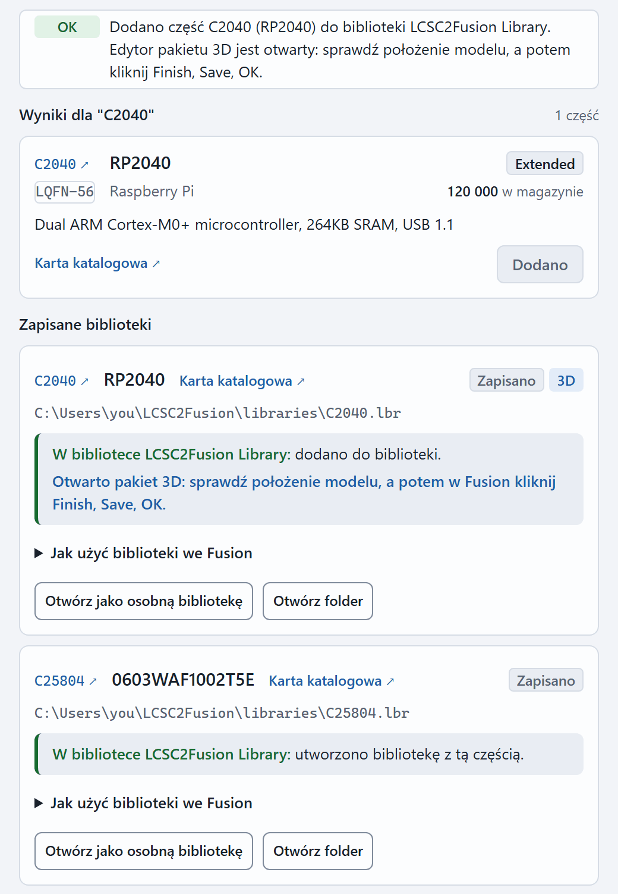
</picture></p>

- Karta pokazuje link do LCSC, MPN, link do karty katalogowej, znaczniki „Zapisano” i „3D” oraz ścieżkę pliku
  `.lbr` (domyślnie `C:\Users\<ty>\LCSC2Fusion\libraries\<id>.lbr`).
- Kolorowe pole mówi, gdzie jest część: „W bibliotece LCSC2Fusion Library: dodano do biblioteki.” albo „Jeszcze nie
  ma jej w bibliotece Fusion.” Błędy też są tam pokazane, razem z powodem.
- **Dodaj do biblioteki Fusion** pojawia się, dopóki części nie ma jeszcze w bibliotece (na przykład gdy
  odznaczyłeś opcję). **Otwórz jako osobną bibliotekę** otwiera tylko ten `.lbr` jako własny dokument w edytorze
  Electronics, potem zapisz go w projekcie. **Otwórz folder** pokazuje pliki w Eksploratorze.
- Bez przekazania do Fusion karta z 3D wypisuje ręczne kroki dołączenia modelu:

<p align="center"><picture>
<source media="(prefers-color-scheme: dark)" srcset="docs/img/ui-manual-3d-dark-pl.png">
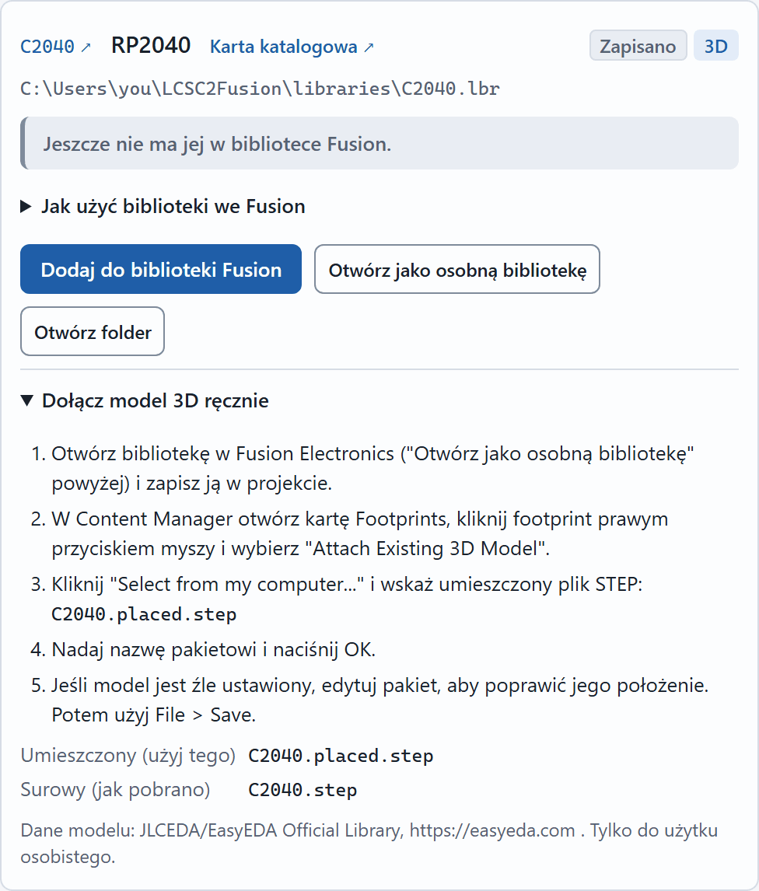
</picture></p>

### 6. Ustawienia

Przycisk Ustawienia w nagłówku otwiera mały panel. Motyw: Systemowy (zgodny z Windows), Jasny lub Ciemny. Język:
English lub Polski. Przy pierwszym starcie wybierany jest język przeglądarki okna. Oba wybory są pamiętane w
profilu przeglądarki tego okna i działają od razu, bez utraty wyników i kart. Trzecia grupa, Aktualizacje, zawiera
pole „Sprawdzaj aktualizacje raz dziennie” i przycisk „Sprawdź teraz” (zob. [Aktualizacje](#7-aktualizacje)).

<p align="center"><picture>
<source media="(prefers-color-scheme: dark)" srcset="docs/img/ui-settings-dark-pl.png">
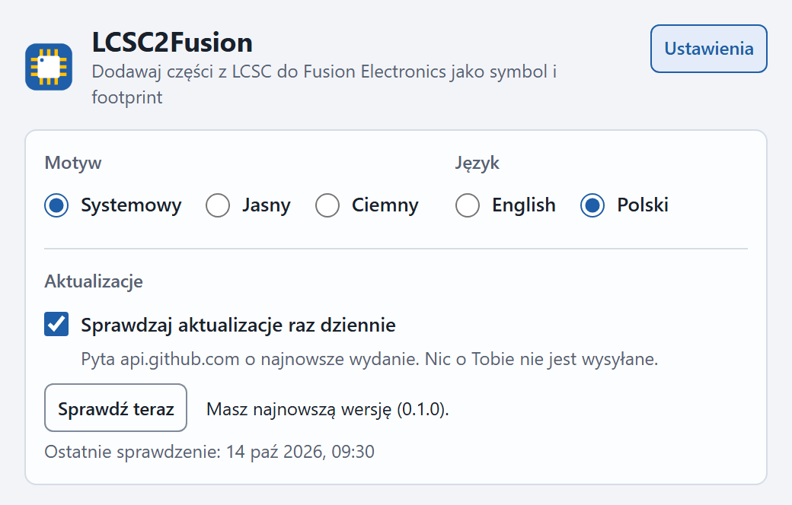
</picture></p>

### 7. Aktualizacje

Okno informuje, gdy na GitHubie jest nowsze wydanie. Tylko informuje: dodatek sam niczego nie pobiera, nie
instaluje ani nie uruchamia.

<p align="center"><picture>
<source media="(prefers-color-scheme: dark)" srcset="docs/img/ui-update-dark-pl.png">
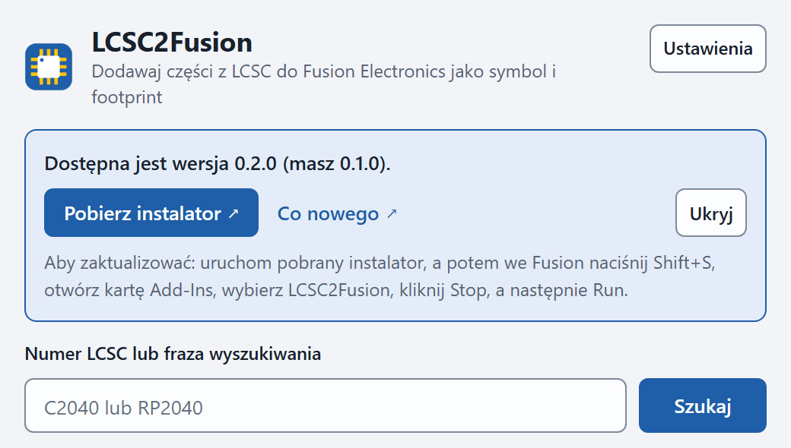
</picture></p>
<p align="center"><sub>Dane przykładowe: numery wersji są ilustracyjne.</sub></p>

- **Kiedy sprawdza.** Gdy otwiera się okno, najwyżej raz dziennie, a po nieudanej próbie nie wcześniej niż po 6
  godzinach. Nie sprawdza w tle, gdy Fusion działa bez okna. „Sprawdź teraz” w Ustawieniach pyta od razu.
- **Powiadomienie.** Nad polem wyszukiwania: „Dostępna jest wersja 0.2.0 (masz 0.1.0).” z elementami „Pobierz
  instalator” (link do pliku instalatora tego wydania), „Co nowego” (strona wydania) i „Ukryj” (chowa
  powiadomienie do czasu pojawienia się nowszej wersji). Pod spodem są kroki: uruchom instalator, potem we Fusion
  naciśnij Shift+S, otwórz kartę Add-Ins, wybierz LCSC2Fusion, kliknij Stop, a następnie Run. Jeśli wydanie nie ma
  pliku instalatora, powiadomienie wskazuje tylko stronę wydania.
- **Co jest wysyłane.** Jedno żądanie HTTPS do `api.github.com` o najnowsze wydanie `KAJPER/lcsc2fusion`.
  Zawiera wersję dodatku w nagłówku User-Agent (na przykład `LCSC2Fusion/0.1.0`) i nic, co by Cię identyfikowało:
  żadnego konta, tokenu, ciasteczka ani identyfikatora komputera. GitHub widzi Twój adres IP, tak jak każdy serwer
  WWW, z którym się łączysz. Dodatek niczego nie pobiera ani nie uruchamia, a treść wydania nigdy nie jest pokazywana:
  dodatek czyta tylko numer wersji i nazwy dołączonych plików, a linki buduje sam.
- **Wyłączenie.** Ustawienia, Aktualizacje, odznacz „Sprawdzaj aktualizacje raz dziennie”. Dodatek nie wysyła
  wtedy żadnych automatycznych żądań. Twój wybór i ostatni wynik są w `%LOCALAPPDATA%\LCSC2Fusion\update.json`.
- **Ograniczenia.** Bez internetu albo za proxy, które blokuje `api.github.com`, automatyczne sprawdzanie po cichu
  nic nie robi. Dopiero „Sprawdź teraz” pokazuje komunikat: „Nie udało się sprawdzić aktualizacji. Spróbuj
  ponownie później.” Używane są systemowe ustawienia proxy. Aktualizacja zawsze jest Twoim krokiem: instalator
  aktualizuje w miejscu i zachowuje Twoje dane.

## Rozwiązywanie problemów

| Problem | Co zrobić |
| --- | --- |
| Windows pisze „System Windows ochronił ten komputer”, gdy uruchamiam instalator. | Instalator nie jest jeszcze podpisany cyfrowo. Wybierz „Więcej informacji”, potem „Uruchom mimo to”, albo użyj zipa instalatora i najpierw przeczytaj jego skrypty. Zob. Instalacja i [Polityka podpisywania kodu](#polityka-podpisywania-kodu). |
| LCSC2Fusion nie ma na liście Add-Ins. | Uruchom instalator ponownie albo sprawdź, czy istnieje `%APPDATA%\Autodesk\FusionAddins\LCSC2Fusion\LCSC2Fusion.manifest` (a nie o folder głębiej). Jeśli zip rozpakowałeś ręcznie, najpierw go odblokuj (Właściwości, Odblokuj). Albo dodaj folder zielonym plusem. Uruchom Fusion ponownie. |
| Okno się nie otwiera. | Uruchom dodatek (Shift+S, Add-Ins). Naciśnij przycisk na pasku jeszcze raz. Zrób Stop i Run. Zajrzyj do okna Text Commands po linie zaczynające się od `[LCSC2Fusion]`. |
| Przycisku brakuje w jednym środowisku. | Okno Text Commands zawiera linie `button: ... -> added, exists, missing lub failed` dla każdego środowiska. Na razie użyj przycisku w Design. |
| „Żądanie nie powiodło się.” albo „Utracono połączenie z Fusion.” | Okno nie może połączyć się z dodatkiem: Fusion został zamknięty, dodatek zatrzymany albo Fusion długo nie odpowiadał. Upewnij się, że Fusion działa i dodatek jest uruchomiony, potem spróbuj ponownie. Okno z poprzedniej sesji można zamknąć. |
| Fusion przestaje odpowiadać nawet na minutę. | To normalne podczas dołączania części lub importu modelu 3D (około 50 s dla małego pliku STEP). Poczekaj. W logu może pojawić się „Hang detected”, a Fusion wraca do normy. |
| Okno z napisem „Can't rename ... Error code: 5”. | Rzadki błąd Fusion, widziany raz, tuż po pierwszym utworzeniu biblioteki (DECISIONS.md, D-026). Zamknij okno. Jeśli części potem brakuje, dodaj ją jeszcze raz: dodatek powie, gdy już tam jest. Jeśli błąd wraca, zgłoś go razem z logiem Fusion. |
| „Fusion nie ma projektu, w którym można przechowywać bibliotekę.” | Zaloguj się do Hub i wybierz projekt w Data Panel, potem dodaj część ponownie. |
| Część jest „już w bibliotece LCSC2Fusion Library”. | Nic nie trzeba robić. Przy zaznaczonym 3D pakiet 3D powstaje od nowa. Jeśli usunąłeś bibliotekę we Fusion, dodatek to zauważy i utworzy nową. |
| Model 3D leży na boku. | Po D-026 nie powinno się zdarzać. Jeśli się zdarzy, popraw go w edytorze pakietu i zgłoś część razem z plikiem `<id>.3d.json`. |
| Fusion działa w innym języku. | Ręczne kroki 3D cytują angielskie nazwy (Content Manager, Footprints, Attach Existing 3D Model, Select from my computer...). W innych językach Fusion nazwy są inne, więc szukaj odpowiedników. |
| „... zablokował żądanie (HTTP 403)” albo „Żądania do ... są wstrzymane”. | Endpointy są nieoficjalne i mogą odrzucać żądania. Takie blokady zwykle ustępują w kilka minut, a komunikat podaje, ile czekać. W tym czasie nowe żądania są celowo odrzucane, więc nie powtarzaj wyszukiwań w pętli. |

## Wiersz poleceń

```
python -m lcsc2fusion C2040 -o out/                   # zapisuje out/C2040.lbr
python -m lcsc2fusion C2040 C14663 -n mylib -o out/   # kilka części w jednej bibliotece
python -m lcsc2fusion --search 100nF 0603             # lista wyników wyszukiwania
python -m lcsc2fusion 100nF 0603 --pick 1 -o out/     # konwersja pierwszego wyniku
python -m lcsc2fusion C2040 --render -o out/          # dodatkowo PNG footprintu i symbolu
python -m lcsc2fusion C25804 --3d -o out/             # dodatkowo pobiera model 3D (STEP)
python -m lcsc2fusion --help                          # wszystkie opcje
```

Domyślny folder wyjściowy to `out`. Odpowiedzi z danymi części są cache'owane na dysku przez 7 dni (zob. [Prywatność](#prywatność)), a żądania mają ograniczoną
częstotliwość. `--no-cache` pobiera dane od nowa. Sam konwerter potrzebuje tylko Pythona. `--render` wymaga
matplotlib (`pip install -r requirements-dev.txt` w wirtualnym środowisku).

<table align="center"><tr>
<td align="center">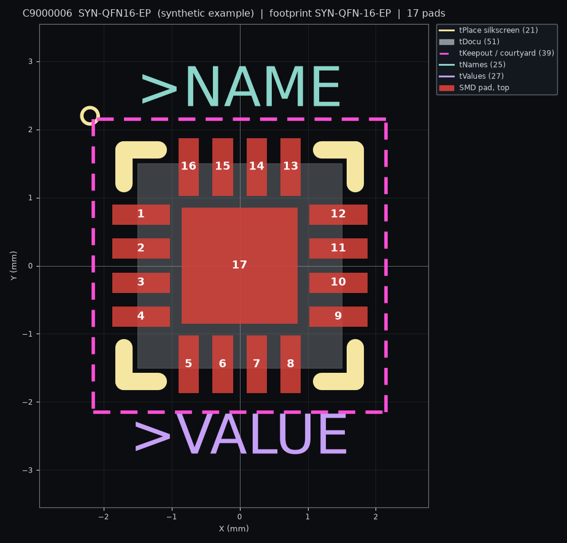</td>
<td align="center">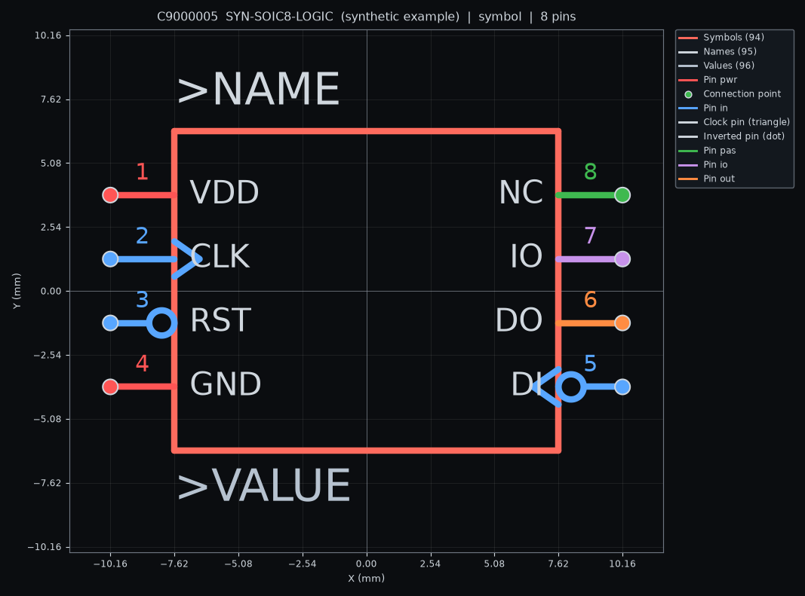</td>
</tr></table>
<p align="center"><sub>To, co zapisuje <code>--render</code>, tu dla syntetycznych części przykładowych z <code>tests/fixtures/synthetic</code> (nie są to prawdziwe dane LCSC). Pad termiczny (pad 17) jest w wyniku zwykłym padem SMD.</sub></p>

**Pliki 3D.** Z `--3d` (pole „Dołącz model 3D (STEP)” w oknie) obok `.lbr` powstają trzy pliki:

| Plik | Co to jest |
| --- | --- |
| `<id>.placed.step` | Model przesunięty do układu pakietu: milimetry, Z w górę, początek w początku footprintu, spód na płytce. Użyj tego. |
| `<id>.step` | Model w stanie pobranym. Nie jest wyrównany do footprintu (dla C25804 był obrócony o 90 stopni), więc nie używaj go bezpośrednio. |
| `<id>.3d.json` | Położenie, sumy kontrolne i atrybucja. |

Z wiersza poleceń model dołączasz sam: otwórz bibliotekę, Content Manager, Footprints, prawy przycisk na
footprincie, „Attach Existing 3D Model”, „Select from my computer...”, wskaż `<id>.placed.step`. Dane 3D należą do
JLCEDA/EasyEDA: tylko do użytku osobistego, nie rozpowszechniaj plików STEP.

## Użycie z innym Claude (MCP)

`python -m lcsc2fusion.mcp` to serwer MCP (stdio, tylko biblioteka standardowa). Claude Code lub Claude Desktop
mogą wyszukiwać w LCSC, oglądać część, konwertować ją i, przez działający dodatek, dodawać ją do Twojej
biblioteki Fusion.

1. Niczego nie instaluj. Uruchom `claude` w folderze repozytorium (Python 3.11+ w `PATH`).
2. Zatwierdź serwer projektu `lcsc2fusion` z `.mcp.json`, gdy zapyta o to Claude Code. Uruchamia on kod z tego
   folderu, więc najpierw przeczytaj ten plik.
3. Uruchom Fusion z działającym dodatkiem i poproś na przykład: „Dodaj RP2040 C2040 razem z modelem 3D do mojej biblioteki Fusion.”

Narzędzia: `lcsc_search`, `lcsc_part_info`, `lcsc_convert`, `fusion_status`, `fusion_add_part`, `fusion_job`.
Rejestracja dla innych folderów i dla Claude Desktop, lokalne API dodatku, uwagi o bezpieczeństwie i przykładowa
rozmowa są w [docs/MCP.md](docs/MCP.md) (po angielsku). Obowiązują warunki poniżej: nie używaj tego do masowego
pobierania danych.

## Ograniczenia i kwestie prawne

- **Warunki korzystania.** Regulamin EasyEDA zabrania masowego lub systematycznego automatycznego dostępu oraz
  używania jego treści do uczenia maszynowego, a jego `robots.txt` wyklucza `/api/`. To narzędzie pobiera
  pojedyncze części na żądanie użytkownika, z cache i ograniczaniem częstotliwości, ale to Ty odpowiadasz za
  przestrzeganie warunków EasyEDA/JLCEDA i LCSC. Dane biblioteki pozostają własnością JLCEDA/EasyEDA, a wygenerowane
  biblioteki niosą wymaganą atrybucję („JLCEDA/EasyEDA Official Library”, https://lceda.cn/, https://easyeda.com).
  Użycie komercyjne danych EasyEDA dopuszcza tylko wtedy, gdy są używane w EasyEDA. To nie jest porada prawna.
- Endpointy są nieoficjalne i mogą się zmienić lub zacząć blokować bez uprzedzenia.
- API Electronics we Fusion jest tylko do odczytu. Otwieranie wygenerowanej biblioteki używa nieudokumentowanych
  komend tekstowych (z ręcznym planem awaryjnym), które mogą zmienić się między wersjami Fusion.
- Konwersje ze stratami: pady wielokątne stają się prostokątami, prostokąty przelotowe stają się padami
  kwadratowymi, rozszerzenia maski i pasty dla pojedynczego pada nie mają odpowiednika, pady termiczne to zwykłe
  pady SMD, a owalne pady przelotowe stosują wydłużenie z DRC.
- Pady niemetalizowane (Eagle ich nie ma) są zapisywane jako metalizowane. Piny symboli zachowują siatkę 1,27 mm
  z EasyEDA, więc Fusion może zgłaszać piny „off grid” dla niektórych symboli. Symbole wieloczęściowe stają się
  kilkoma gate'ami. Linki do kart katalogowych są podawane na zasadzie „best effort”.
- Konwencje obrotu i kierunku łuków wyprowadzono z danych przykładowych i sprawdzono z podglądami EasyEDA, a
  położenie 3D potwierdzono we Fusion dla trzech części. Reguły obrotu padów i łuków nie są jeszcze potwierdzone
  we Fusion. Przed zamówieniem płytki sprawdź wygenerowany footprint z kartą katalogową (pomaga `--render`).
- Fusion zawiesza się nawet na minutę podczas dołączania części, a dodatek obsługuje jedną część naraz.
- Autodesk, Fusion, EasyEDA, JLCPCB i LCSC to znaki towarowe ich właścicieli. Projekt nie jest z nimi powiązany.

## Polityka podpisywania kodu

**Stan.** Pliki wydań nie są jeszcze podpisane cyfrowo, więc Windows pokazuje przy instalatorze „nieznanego wydawcę” (zob. [Instalacja](#instalacja)). Opiekun projektu stara się o darmowy podpis kodu dla projektów open source od [SignPath Foundation](https://signpath.org/) (angielski termin tej sekcji to „Code signing policy”). Podpisu jeszcze nie przyznano. Gdy zostanie przyznany i wyjdzie podpisane wydanie, ta sekcja o tym powie, a do tego czasu nic tu nie twierdzi, że podpis istnieje. Reszta sekcji to polityka, która będzie obowiązywać dla podpisanych wydań.

**Role.** To projekt jednej osoby, więc jedna osoba pełni wszystkie role.

| Rola | Osoba | Co to znaczy |
| --- | --- | --- |
| Autorzy zmian i recenzenci (committers and reviewers) | Kacper Popko ([@KAJPER](https://github.com/KAJPER)) | Zmienia kod źródłowy. Przegląda każdą zmianę proponowaną przez innych w pull requeście, zanim zostanie włączona. |
| Zatwierdzający (approvers) | Kacper Popko ([@KAJPER](https://github.com/KAJPER)) | Zatwierdza ręcznie każde żądanie podpisania. Bez tego zatwierdzenia nic nie jest podpisywane. |

**Co jest podpisywane.** Tylko pliki, które ten projekt buduje z własnego kodu źródłowego. Do podpisania przeznaczony jest `LCSC2Fusion-Setup-<version>.exe`, bo to w nim Windows pokazuje wydawcę. Niepodpisane: skrypty w `LCSC2Fusion-<version>-installer.zip` (`Install-LCSC2Fusion.bat` i skrypty PowerShell), `LCSC2Fusion-<version>-addin.zip`, same pliki zip (zip nie może nieść podpisu) oraz `SHA256SUMS.txt`. Ich integralność sprawdza się przez `SHA256SUMS.txt`, zob. [Instalacja](#instalacja).

**Skąd pochodzą podpisane pliki.** Tylko z workflow wydania w tym repozytorium (`.github/workflows/release.yml`, uruchamianego przez wypchnięty tag `v*`, na runnerach hostowanych przez GitHub). Workflow buduje pliki z otagowanego kodu i wysyła exe do SignPath, które przed podpisaniem sprawdza, że plik zbudował to workflow z tego repozytorium. Podpis certyfikatem Fundacji nigdy nie powstaje na komputerze opiekuna projektu.

**Nazwa wydawcy.** Gdy podpisywanie zacznie działać, Windows pokaże jako wydawcę „SignPath Foundation”, bo certyfikat należy do Fundacji, a nie do opiekuna projektu.

**Jak sprawdzić podpisany plik.** W PowerShellu, w folderze z pobranym plikiem:

```
Get-AuthenticodeSignature .\LCSC2Fusion-Setup-<version>.exe | Format-List Status, SignerCertificate
```

`Status` musi mieć wartość `Valid`, a podpisującym musi być SignPath Foundation. W Eksploratorze: prawy przycisk na pliku, Właściwości, Podpisy cyfrowe, Szczegóły. Plik zmieniony po podpisaniu pokazuje `HashMismatch`. Sprawdzenie `SHA256SUMS.txt` z sekcji [Instalacja](#instalacja) działa dla każdego wydania, podpisanego lub nie.

**Czego podpis nie załatwia.** Nadaje plikowi nazwę wydawcy. Nie dowodzi, że program nie ma błędów, a SmartScreen ocenia też reputację pliku, więc po pierwszym podpisanym wydaniu może jeszcze przez jakiś czas ostrzegać. Wydania sprzed tego momentu pozostają niepodpisane.

## Prywatność

LCSC2Fusion nie ma telemetrii, analityki, reklam ani kont, a projekt nie prowadzi żadnego serwera. Nic z Twoich plików Fusion ani projektów nie jest nigdzie wysyłane. Program łączy się tylko z hostami wymienionymi niżej, przez HTTPS.

**Z kim program się łączy i co wysyła.**

| Host | Do czego | Co jest wysyłane |
| --- | --- | --- |
| `easyeda.com` | Symbol i footprint części, gdy szukasz po numerze LCSC albo dodajesz część | Numer LCSC, na przykład `C2040`, a potem identyfikator EasyEDA, który odpowiedź podaje dla tej części |
| `modules.easyeda.com` | Model 3D, tylko z „Dołącz model 3D (STEP)” lub `--3d` | Identyfikator modelu (32 cyfry szesnastkowe z footprintu), w adresie |
| `wmsc.lcsc.com` | Link do karty katalogowej, tylko gdy dane EasyEDA części go nie mają | Numer LCSC |
| `jlcpcb.com` | Wyszukiwanie po słowach zamiast po numerze | Wpisany tekst i liczba oczekiwanych wyników |
| `api.github.com` | Opcjonalne sprawdzanie aktualizacji, zob. [Aktualizacje](#7-aktualizacje) | Nic od Ciebie: pyta o najnowsze wydanie `KAJPER/lcsc2fusion` |

Każde żądanie niesie nagłówek User-Agent z nazwą programu i wersją (`lcsc2fusion/0.1.0 (+https://github.com/KAJPER/lcsc2fusion)` dla danych części, `LCSC2Fusion/0.1.0` dla sprawdzania aktualizacji) oraz zwykłe nagłówki klienta HTTP. Host widzi Twój adres IP, tak jak każdy serwer WWW. Nic więcej nie jest wysyłane: żadnego konta, ciasteczka (program żadnych nie wysyła ani nie zachowuje), tokenu, identyfikatora komputera, nazwy użytkownika Windows ani konta Fusion czy Autodesk. Używane są systemowe ustawienia proxy.

**Pamięć podręczna i limity.** Odpowiedzi są trzymane na Twoim dysku, więc powtórzone zapytanie zwykle nic nie wysyła: dane części przez 7 dni, modele 3D przez 30 dni, wyniki wyszukiwania przez 1 godzinę. Żądania wychodzą po jednym, w odstępie co najmniej pół sekundy. Narzędzie wiersza poleceń i serwer MCP używają tego samego klienta, z tymi samymi hostami, pamięcią podręczną i limitami; serwer MCP nie otwiera żadnego innego połączenia poza tym z dodatkiem na Twoim komputerze.

**Co zostaje na Twoim komputerze.**

- `%LOCALAPPDATA%\LCSC2Fusion\cache`: zapamiętane odpowiedzi. Widać w nich, jakich części szukałeś.
- `%LOCALAPPDATA%\LCSC2Fusion\state.json`: biblioteka i części, które dodatek już dołączył.
- `%LOCALAPPDATA%\LCSC2Fusion\update.json`: czy sprawdzanie aktualizacji jest włączone, kiedy ostatnio działało, najnowsza widziana wersja i wersja, którą ukryłeś.
- `%LOCALAPPDATA%\LCSC2Fusion\api.json`: tylko gdy dodatek działa, lokalny adres i losowy token dla serwera MCP. Znika po zatrzymaniu dodatku.
- `%LOCALAPPDATA%\LCSC2Fusion\browser-profile`: prywatny profil przeglądarki okna, w którym jest też wybrany motyw i język.
- `C:\Users\<ty>\LCSC2Fusion\libraries`: pliki `.lbr`, a przy 3D pliki STEP i `.3d.json`.
- `%TEMP%\LCSC2Fusion-setup.log`: log instalatora exe.

**Usuwanie.** `Uninstall-LCSC2Fusion.bat -RemoveData` (najpierw pyta) usuwa `%LOCALAPPDATA%\LCSC2Fusion`, albo usuń ten folder sam; samą pamięć podręczną można skasować w każdej chwili, wypełni się znów, gdy będzie potrzebna. Folder z bibliotekami nigdy nie jest ruszany przez dezinstalator. „LCSC2Fusion Library” w Twoim projekcie Hub należy do Fusion: usuń ją we Fusion.

**Tylko lokalnie.** Okno i lokalne API dla serwera MCP nasłuchują na `127.0.0.1` i nic nie wysyłają na zewnątrz. Strona niczego nie ładuje z internetu (jej polityka bezpieczeństwa treści to `default-src 'self'`). Link do LCSC albo do karty katalogowej otwiera się w Twojej przeglądarce dopiero po kliknięciu, a ta strona widzi wtedy Twoją przeglądarkę jak każda witryna.

**Wyłączenie sprawdzania aktualizacji.** Ustawienia, Aktualizacje, odznacz „Sprawdzaj aktualizacje raz dziennie”. Dodatek nie wysyła wtedy żadnych automatycznych żądań; pyta tylko przycisk „Sprawdź teraz”, gdy go naciśniesz. Instalator w ogóle nie łączy się z siecią.

**Poza tym projektem.** Fusion zapisuje bibliotekę w Twoim projekcie Hub własnym połączeniem z Autodesk, na warunkach Autodesk. Okno to zwykłe okno Edge lub Chrome, a to, co ta przeglądarka wysyła do swojego producenta, zależy od niej. Serwer MCP przekazuje wyniki wyszukiwania i dane części asystentowi, z którym go połączyłeś, a dostawca tego asystenta traktuje je według własnej polityki. Jeśli zauważysz żądanie, którego ta sekcja nie wymienia, to jest błąd: zgłoś go w issue.

## Rozwój projektu

```
python -m venv .venv
.venv\Scripts\activate            # na macOS/Linux: source .venv/bin/activate
pip install -r requirements-dev.txt
python -m pytest                  # testy offline, bez sieci
ruff check . && ruff format .
mypy lcsc2fusion
```

Fixture'y w `tests/fixtures/synthetic/` generuje `tests/fixtures/synthetic/generate.py` razem z niezależnie
policzonymi wartościami oczekiwanymi (pozycje i rozmiary padów, pozycje pinów w mm). Testy oznaczone `real`
używają dodatkowo `tests/fixtures/real/*.json` (odpowiedzi EasyEDA pobrane przez `python scripts/fetch_fixtures.py`);
ten katalog jest w `.gitignore`, bo treść należy do EasyEDA. `python scripts/make_manual_test_assets.py` buduje pliki
do ręcznej listy kontrolnej w [docs/MANUAL_TEST.md](docs/MANUAL_TEST.md).

Aby pracować nad dodatkiem bez budowania, dodaj `addin/LCSC2Fusion` zielonym plusem w Scripts and Add-Ins. Aby
zobaczyć okno bez Fusion, otwórz `addin/LCSC2Fusion/palette/index.html` w przeglądarce: przełączy się w tryb
demonstracyjny z fałszywymi danymi. Szczegóły są w [addin/README.md](addin/README.md) (po angielsku), badania i
decyzje w [docs/RESEARCH.md](docs/RESEARCH.md) i [DECISIONS.md](DECISIONS.md).

## Struktura projektu

```
lcsc2fusion/            rdzeń, bez importu adsk
  client/               HTTP, cache na dysku, rate limiting, retry, wyszukiwanie
  parser/               ciągi kształtów EasyEDA do modelu wewnętrznego (jedno miejsce na jednostki i osie)
  lbr_writer/           model do XML Eagle oraz linter zgodności z Fusion
  render.py             PNG/SVG footprintu i symbolu do kontroli wizualnej
  step.py, service.py   transformacja modelu 3D i operacje wysokiego poziomu dla wszystkich interfejsów
  cli/                  wiersz poleceń
  mcp/                  serwer MCP dla innych Claude
addin/LCSC2Fusion/      dodatek Fusion: manifest, adapter (jedyny moduł z adsk), kontroler, strona okna
installer/              skrypty instalatora dla Windows (instalacja, odinstalowanie)
scripts/                build_addin.py, build_release.py i skrypty pomocnicze
tests/                  pytest, fixture'y, pliki wzorcowe
docs/                   RESEARCH.md, MANUAL_TEST.md, MCP.md, img/
.github/workflows/      CI (ruff, mypy, pytest) i workflow wydania
CHANGELOG.md            co zmieniło się w każdej wersji
RELEASING.md            jak powstaje wydanie (dla opiekunów projektu)
```

## Współtworzenie

Zgłoszenia (issues) i pull requesty są mile widziane, zwłaszcza raporty z innych wersji Fusion i z macOS. Przed
pull requestem uruchom pytest, ruff i mypy (zob. Rozwój projektu), nie używaj w tekstach długich myślników (pilnuje
tego test), nie dodawaj zależności bez uzasadnienia zapisanego w [DECISIONS.md](DECISIONS.md) i nigdy nie commituj
odpowiedzi EasyEDA. Komunikaty commitów wyglądają tak: `fix: short description`. Te same kontrole działają na
GitHubie dla każdego pull requesta. Zmiany zauważalne dla użytkowników trafiają do [CHANGELOG.md](CHANGELOG.md)
(po angielsku) w sekcji „Unreleased”.

## Licencja

MIT, zob. [LICENSE](LICENSE). Dane EasyEDA/LCSC nie są objęte tą licencją. Źródło danych: JLCEDA/EasyEDA
Official Library, https://easyeda.com .
